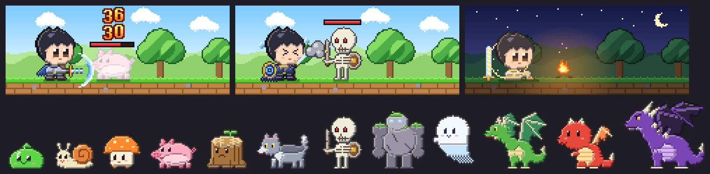

# spellblade — 마검사 키우기

Claude Code 를 쓴 만큼 자라는 판타지 마검사 Claude Mod.
메이플스토리 클래식 느낌의 횡스크롤 장면에서, Claude 가 일하는 동안 마검사는 앞의 몬스터와 싸우고 일이 끝나면 모닥불 앞에서 쉰다.
도구를 쓰면 기술 이름을 외치며 베고, 답을 쓰는 동안 칼끝에 마법을 모아 쏘고, 쓴 토큰만큼 경험치가 쌓여
수련생 → 검사 → 마검사 → 마검기사 → 마검성 → 마검제 → 검신(만렙 Lv.100)으로 자란다. 꾸준히 쓰면 만렙까지 석 달쯤 걸린다.
장비는 5레벨마다 20단계, 몬스터는 3레벨마다 33종, 10레벨마다 보스 10마리, 맵은 20레벨마다 숲 · 늪 · 동굴 · 협곡 · 성 5곳.
터미널 `claude` 와 데스크톱 앱 Code 탭 양쪽에서 보인다.

그림은 [Elthen's Pixel Art Shop](https://elthen.itch.io) 의 무료 픽셀 그림을 쓴다. 그림은 저장소에 없고, 각자 받아서 묶음 파일을 만든다([그림 묶음](#그림-묶음)).
묶음이 없으면 이 프로젝트가 그린 기본 그림(아래, 3.0 그림)으로 그린다.



## 어디에 보이나

| 자리 | 터미널 | 데스크톱 앱 |
|---|---|---|
| 스피너 옆 `· ⚔️ Lv.27 마검사 +34xp` | O | O |
| 프롬프트 위 밴드 | 글 한 줄 — 레벨 · XP · ❤️ · 🔷 · 몬스터 체력 · 오늘 토큰 · 🪙 골드 | 장면 320×128(발밑 이름표) + 글 6줄(칭호 · 레벨 · XP 막대 / 체력 · 마나 / 상태 / 오늘 경험치(토큰) · 금화 그림 · 골드 / 의뢰 · 🔥 출석 / 🎒 배낭 용량) |
| `/blade` 카드 창 — 상태 · 의뢰 · 기록 탭 | 창이 크면(160칸 × 44줄 이상) 장면, 아니면 글만 | 장면 480×192 + 승급의 길 그림 |
| 레벨업 · 승급 · 의뢰 완료 · 새 칭호 | 배너 · 토스트 | 배너 · 토스트 · 장면의 「LEVEL UP」 빛기둥 |

데스크톱에서 창이 좁거나(84칸 미만) 밴드가 낮으면(10줄 미만) 밴드는 한 줄로 바뀐다. 다른 Mod 가 밴드에 그린 것은 가리지 않는다.
장면과 밴드 높이는 상태가 바뀌어도 흔들리지 않는다(장면 크기 고정 · 밴드 글 6줄 고정 · 마검사 · 몬스터 자리 고정).

**장면**: 그림 묶음이 있으면 80×32 점(밴드 4px · 카드 6px, 터미널은 2배로 늘려 160칸 × 32줄), 없으면 기본 그림 160×64 점. 화면에 보이는 크기는 같다.

| 상태 | 언제 | 장면 |
|---|---|---|
| 전투 대기 | 턴 중 쉬는 사이, 턴이 끝나고 2분 동안 | 그 레벨 맵의 낮, 칼을 든 마검사와 숨 쉬는 몬스터(큰 보스는 화면 위 · 오른쪽이 잘린다) |
| 베기 | 도구를 부를 때 | 초승달 칼 궤적 · 데미지 숫자 · 몬스터 체력 막대가 준다 |
| 영창 · 마법 적중 | 답을 쓰는 동안 · 단계가 끝나면 | 칼끝 마법 빛 → 마법 탄이 몬스터에 맞는다 |
| 캐스팅 실패 | 단계의 캐시 재사용이 50% 미만 | 「> <」 눈 · 땀 · 칼끝 잿빛 연기(연출만, 손해 없음) |
| 반격 | 도구 오류(Esc 로 끊은 것은 아님) | 몬스터가 치고 마검사가 맞는다 |
| 처치 | 몬스터 체력 0 | 연기와 함께 사라지고 「+N XP」, 같은 자리에 다음 몬스터 |
| 승리 | 턴이 정상 답변으로 끝남 | 마법 결과 뒤에 승리 자세 2초 |
| 휴식 · 졸기 | 턴이 끝나고 2분 · 30분 | 그 맵의 밤, 모닥불 앞에서 쉬기 · Zzz |

## 게임 규칙

- **경험치**: 💥 위력 `W = 시전(출력) + 0.1 × (주문서(입력) + 외워 둠(캐시 쓰기))` — 외워 둔 주문을 다시 꺼내 쓴 몫(캐시 읽기)은 빼고, `XP = 위력 ÷ 1,000`. 서브에이전트 몫도 센다.
- **레벨**: 레벨 L 누적 XP = `1,000 × (L − 1)^1.25`, 만렙 100(312,280 XP). 하루 3,600 XP 쯤 쓰면 만렙까지 90일쯤. 만렙 뒤 XP 1,000 = 명성 ★1.
  3.x 에서 옮겨 오면 처음 켤 때 한 번 새 곡선의 레벨로 바뀌고 일지에 「레벨 100 체계로 바뀜 — Lv.<옛> → Lv.<새>」 가 남는다(경험치는 그대로).
- **단계**: 수련생(Lv.1) · 검사(10) · 마검사(25) · 마검기사(45) · 마검성(65) · 마검제(85) · 검신(100).
- **장비**: 5레벨마다 20단계 — 나무 검 · 천 옷에서 시작해 … 화염검 · 빙결검 · 용살검 · 흑요검 · 별빛검 · 천공검 · 마검 「여명」 · 마검 「황혼」 · 천공의 성검까지. 단계마다 마검사의 옷 · 스카프 · 칼 색이 바뀌고, 10단계(Lv.50)부터 몸에 빛 테두리가 생긴다. 같은 장비 단계 안에서 오른 레벨만큼 무기에 `+N` 강화.
- **맵 · 몬스터**: 20레벨마다 맵이 바뀐다 — 숲(Lv.1~19) · 늪(20~39) · 동굴(40~59) · 협곡(60~79) · 성(80~100). 몬스터는 3레벨마다 33종(🎯 허수아비 · 🟢 슬라임 · 🦔 고슴도치 … 💀 저주받은 검투사). 체력은 `300 × 1.06^단계`(300 ~ 1,936) — 장비가 좋아지는 만큼 늘어 어느 레벨이든 베기 10~20번.
- **보스**: 10레벨마다 — 고블린 왕 · 마녀 · 두더지 군주 · 사이클롭스 · 도적 강령술사 · 미노타우로스 · 카코데몬 · 피닉슬링(한 번 되살아남) · 인큐버스 · 샤드소울 학살자. 그 레벨에 닿으면 다음 몬스터가 보스(👑, 체력 4배)이고, 잡으면 일지 · 토스트에 남고 다시 나오지 않는다. 여러 문턱을 한꺼번에 넘었으면 가장 높은 보스 하나만. 만렙에서 샤드소울 학살자를 잡은 뒤에는 일반 몬스터 10마리마다 다시 나온다.
- **데미지**: 도구 한 번은 기술마다 정한 값(장비 단계마다 25% 씩 더), 마법 적중은 그 단계의 W ÷ 10. 몬스터를 잡아도 경험치는 따로 늘지 않는다(「+N XP」 는 그 몬스터와 싸우는 동안 얻은 경험치).
- **❤️ 체력 · 🔷 마나**: 체력 = 주간(7일) 한도 남은 %, 마나 = 5시간 한도 남은 %. 마나가 0 이면 「마나 소진」, 체력이 0 이면 「기진맥진」으로 앉아 쉰다(벌은 없음). 구독이 아니면 숨긴다.
- **🎒 배낭 용량**: 이 대화가 컨텍스트 창을 채운 %. 80% 를 넘으면 「/compact 로 정리」가 붙는다.
- **오늘 경험치 · 🪙 골드**: 밴드의 「오늘 경험치」는 오늘 모든 창(세션)에서 쓴 토큰 전부(입력 · 출력 · 캐시 쓰기 · 캐시 읽기)이고, 골드는 그 토큰을 API 요금으로 친 값이다(1 골드 = $1, Vorssaint 의 「API 환산 금액」과 같은 셈). 단계마다 그 단계 모델의 100만 토큰당 값(입력 · 출력 · 캐시 읽기, 캐시 쓰기는 입력의 1.25배)으로 더하고, 모르는 모델 · 3.0.4 전에 쌓인 토큰은 기본 모델(Opus 5.5) 값으로 친다. 구독이면 실제로 내는 돈이 아니다. 데스크톱 밴드 · 기록 탭은 금화 그림, 터미널은 🪙. 레벨 경험치(XP)는 카드 상태 탭 · 기록 탭에 그대로 있다. 값은 `hooks/lib/price.ts` 한 곳에 있다.
- **🎯 마법 적중률**: Claude 가 답을 쓸 때마다(메인 대화의 단계) 마검사가 마법을 한 발 쏜다. 외워 둔 주문을 기억하면 적중, 처음부터 다시 읽어야 하면 캐스팅 실패(연출만, 손해 없음) — 그 단계의 캐시 재사용(캐시 읽기 ÷ (입력 + 캐시 쓰기 + 캐시 읽기))이 50% 미만이면 실패다. 새 대화 첫 답 · 오래 쉰 뒤 · `/compact` 직후에 주로 빗나간다. `/blade` 카드 기록 탭에 이번 턴 · 이 세션의 적중 수와 오늘 적중률(적중 ÷ 쏜 수)이 보인다.
- **기술 · 콤보**: 도구마다 기술 이름(Bash 폭풍 베기 · Read 탐색의 눈 · Edit 연성 베기 · Agent 분신술 …). 오류 없이 이어진 도구 호출이 `×N 콤보`, 오류(반격)에서 끊긴다. 도구 오류는 Esc 로 끊은 것인지 1초 기다려 본 뒤 반격이 된다.
- **보너스**: 성공한 `git commit` +20, `gh pr create` +50 (하루 합계 300 까지).
- **오늘의 의뢰**: 날짜마다 3개(쉬움 · 보통 · 어려움, 30 · 50 · 80 XP). 창이 여러 개여도 보상은 한 번. 2.0 을 처음 켠 날부터 센다(지난날 소급 없음).
- **연속 출석 · 칭호 10개 · 능력치 4개**(힘 · 지력 · 민첩 · 행운). 칭호는 이름 앞에 붙는다.
- 경험치는 줄지 않는다. 숫자는 `plugins/spellblade/hooks/lib/balance.ts` 한 곳에 있다.

여러 창을 동시에 켜도 세션마다 자기 칸(`d:<날짜>:<세션>`)에만 쓰고 읽을 때 합치므로 덮어쓰지 않는다. 의뢰 보상 · 칭호 · 능력치 · 출석은 모두 이 합계에서 계산한다.

## 설치

```bash
claude plugin marketplace add ~/Documents/spellblade
claude plugin install spellblade@spellblade
```

열려 있는 세션에서는 `/reload-plugins` (또는 새 세션). Claude Code 2.1.287 이상(데스크톱 앱 내장 2.1.286 이상)이 필요하다.

업데이트: `plugin.json` 의 `version` 을 올린 뒤

```bash
claude plugin marketplace update spellblade
claude plugin update spellblade@spellblade
```

지우기: `claude plugin uninstall spellblade@spellblade`

## 그림 묶음

Elthen 의 그림은 고쳐서 쓰는 것은 되지만 다시 나눠 주면 안 되므로 저장소에 넣지 않는다. 각자 받아서 묶음 파일 하나로 만든다.

1. [elthen.itch.io](https://elthen.itch.io) 에서 무료(자유가격, 0원) 팩 41개를 받아 `~/Documents/spellblade-packs/elthen/<팩 주소 이름>/` 에 푼다. 받는 팩은 `tools/art/import_elthen.py` 의 `HERO` · `MONSTERS` 표에 있다(주인공 · 몬스터마다 어느 팩 · 줄 · 칸인지).
2. 묶음 만들기:

   ```bash
   python3 tools/art/import_elthen.py check ~/Documents/spellblade-packs/elthen
   python3 tools/art/import_elthen.py build ~/Documents/spellblade-packs/elthen ~/Documents/spellblade-packs/spellblade-pack.json
   ```

3. 새 세션을 켜면 Mod 가 `~/Documents/spellblade-packs/spellblade-pack.json` 을 읽는다. 없거나 깨졌으면 「그림 묶음이 없어 기본 그림으로 그려요」 를 한 번 띄우고 기본 그림으로 그린다. 묶음에 없는 몬스터는 가까운 몬스터를 다른 색으로 물들여 그린다.

## 명령 · 설정

| 명령 | 하는 일 |
|---|---|
| `/blade` | 마검사 카드 창 열기 — 숫자 1 · 2 · 3 으로 상태 · 의뢰 · 기록 탭, Esc 로 닫기 |
| `/blade name <이름>` | 이름 바꾸기 (1~12자) |
| `/blade title [칭호]` | 얻은 칭호 보기 · 이름 앞에 달 칭호 고르기 |
| `/blade demo` | 13초 동안 맵 5곳 × [베기 · 캐스팅 실패 · 모닥불] 다음 보스(사이클롭스) 한 장을 차례로 보여 주기 (저장소는 안 바꿈) |
| `/blade reset` | 한 번 더 물은 뒤 경험치 · 일지를 지우고 처음부터 |

`/blade` 가 내장 명령과 겹치는 버전에서는 `/spellblade` 로 등록된다.

설정(`/config`):
- `band`: `panel`(기본, 그림판) · `line`(한 줄) · `off`(밴드에 안 그림)
- `motion`: 3차에서는 효과 없음(2.x 설정을 그대로 두어도 괜찮다)

## 개발

```bash
claude --plugin-dir plugins/spellblade      # 파일을 저장하면 핫 리로드
claude plugin validate plugins/spellblade   # 훅 · 호출 정적 검사
claude plugin test plugins/spellblade       # 세션 · 네트워크 없이 테스트
```

- `$` 를 쓰는 코드는 `hooks/register.ts` 에만 있고, 계산 · 그림 · 화면 트리는 `hooks/lib/` 의 순수 함수다.
- 4차 장면은 `scene4.ts` 가 그림 묶음(`pack.ts` 가 읽고 검사)과 맵 배경 · 효과 · 글꼴(`art4.ts`)을 80×32 색 격자로 합친다. 장비 색은 `looks.ts`, 몬스터 · 보스 목록은 `roster.ts`. `art4.ts` 는 `tools/art/art4.py` 가 만든다.
- 기본 그림은 재질 글자 격자(`hooks/lib/art3.ts` — 마검사 44×48 · 12단계, 몬스터 12종, 효과 · 글꼴 · 배경)이고, 음영 · 테두리는 `shade.ts` 가 넣는다. 장면은 `scene.ts` 가 160×64 색 격자로 합친다. 레벨 100 은 비율로 12단계에 나눈다.
- `art3.ts` 는 `tools/art/art3.py` 가 만든다 — 그림을 고칠 때는 스크립트를 고치고 `python3 tools/art/art3.py ts plugins/spellblade/hooks/lib/art3.ts`, 미리보기는 `python3 tools/art/art3.py preview docs`.
- `--plugin-dir` 로 띄운 개발본은 설치본과 다른 저장 파일(`~/.claude/plugins/store/spellblade_inline-*.json`)을 쓴다.

## 안전

Mods 는 샌드박스 없이 내 권한으로 돈다. 이 Mod 는 프로세스 · 네트워크 · 모델 호출을 하지 않고, 파일은 그림 묶음 하나(`$HOME/Documents/spellblade-packs/spellblade-pack.json`)를 켤 때 읽기만 한다 — 그 경로를 만들려고 환경 변수 `HOME` 하나를 읽는다. 아무 파일도 쓰지 않는다
(`claude plugin validate` 의 `calls:` 줄에 `$.store` · `$.clock` · `$.session` · `$.ui` · `$.command` 와 `$.fs.read` · `$.env.get`(둘 다 loadPack) 만 나온다).
Bash 명령은 커밋 · PR 보너스를 판정할 때 문자열로만 읽고, 어디에도 저장하지 않는다.

## 라이선스

코드는 MIT. 기본 그림(3.0 그림 · 맵 배경 · 효과 · 글꼴)은 이 프로젝트를 위해 새로 그렸다.
Elthen 그림은 Elthen's Pixel Art Shop 의 약관을 따르고 저장소에 없다(받은 사람 컴퓨터의 묶음 파일에만 있다).
