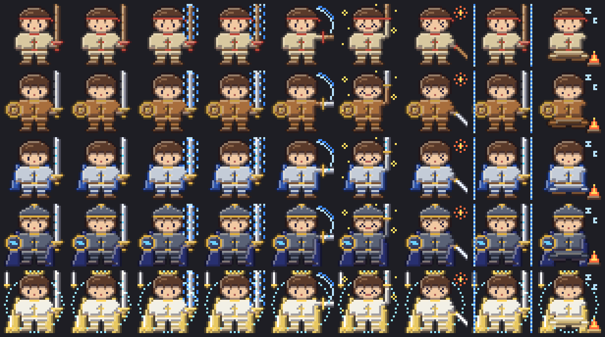

# spellblade — 마검사 키우기

Claude Code 를 쓴 만큼 자라는 판타지 마검사 Claude Mod.
Claude 가 도구를 쓰면 기술 이름을 외치며 검을 휘두르고, 답을 쓰는 동안 검에 마법을 두르고, 쓴 토큰만큼 경험치가 쌓여
수련생 → 검사 → 마검사 → 마검기사 → 마검성(만렙 Lv.60)으로 자란다. 터미널 `claude` 와 데스크톱 앱 Code 탭 양쪽에서 보인다.



## 어디에 보이나

| 자리 | 터미널 | 데스크톱 앱 |
|---|---|---|
| 스피너 옆 `· ⚔️ Lv.17 마검사 +34xp` | O | O |
| 프롬프트 위 밴드 — 마검사 + 칭호 · 레벨 · XP · ❤️ 체력 · 🔷 마나 · 상태 · 오늘 XP · 의뢰 · 🔥 출석 · 🎒 배낭 용량 | 상반신 도트(32×8칸) | 전신 Svg 128px |
| `/blade` 카드 창 — [1] 상태 · [2] 의뢰 · [3] 기록 | 전신 도트(32×16칸) | Svg 192px + 승급의 길 그림 |
| 레벨업 · 승급 · 의뢰 완료 · 새 칭호 | 배너 · 토스트 | 배너 · 토스트 |

창이 좁거나(84칸 미만) 밴드가 낮으면(10줄 미만) 밴드는 한 줄로 바뀐다. 다른 Mod 가 밴드에 그린 것은 가리지 않는다.
그림과 밴드 높이는 자세 · 상태가 바뀌어도 흔들리지 않는다(데스크톱 그림 크기 고정 · 밴드 글 6줄 고정 · 베기 · 반격에도 몸은 제자리).

## 게임 규칙

- **경험치**: `W = 출력 + 0.1 × (입력 + 캐시 쓰기)` (캐시 읽기 제외), `XP = W ÷ 1,000`. 서브에이전트 몫도 센다.
- **레벨**: 레벨 L 누적 XP = `60 × (L − 1)²`, 만렙 60. 만렙 뒤 XP 1,000 = 명성 ★1.
- **단계 · 장비**: 수련생(Lv.1, 나무 검) · 검사(5, 철검 · 둥근 방패) · 마검사(15, 룬 검 · 짧은 망토) · 마검기사(30, 청뢰검 · 긴 망토 · 마법진 방패) · 마검성(45, 성검 · 마법진 · 떠 있는 검). 같은 단계 안에서 오른 레벨만큼 무기에 `+N` 강화.
- **❤️ 체력 · 🔷 마나**: 체력 = 주간(7일) 한도 남은 %, 마나 = 5시간 한도 남은 %. 마나가 0 이면 「마나 소진」, 체력이 0 이면 「기진맥진」으로 앉아 쉰다(벌은 없음). 구독이 아니면 숨긴다.
- **🎒 배낭 용량**: 이 대화가 컨텍스트 창을 채운 %. 80% 를 넘으면 「/compact 로 정리」가 붙는다. 캐시 재사용(이미 읽은 내용을 다시 읽지 않고 넘어간 비율)은 `/blade` 카드 [3] 기록 탭에만 보인다.
- **기술 · 콤보**: 도구마다 기술 이름(Bash 폭풍 베기 · Read 탐색의 눈 · Edit 연성 베기 · Agent 분신술 …). 오류 없이 이어진 도구 호출이 `×N 콤보`, 오류(반격)에서 끊긴다.
- **보너스**: 성공한 `git commit` +20, `gh pr create` +50 (하루 합계 300 까지).
- **오늘의 의뢰**: 날짜마다 3개(쉬움 · 보통 · 어려움, 30 · 50 · 80 XP). 창이 여러 개여도 보상은 한 번. 2.0 을 처음 켠 날부터 센다(지난날 소급 없음).
- **연속 출석 · 칭호 10개 · 능력치 4개**(힘 · 지력 · 민첩 · 행운). 칭호는 이름 앞에 붙는다.
- 경험치는 줄지 않는다. 숫자는 `plugins/spellblade/hooks/lib/balance.ts` 한 곳에 있다.

여러 창을 동시에 켜도 세션마다 자기 칸(`d:<날짜>:<세션>`)에만 쓰고 읽을 때 합치므로 덮어쓰지 않는다. 의뢰 보상 · 칭호 · 능력치 · 출석은 모두 이 합계에서 계산한다.

## 설치

```bash
claude plugin marketplace add ~/Documents/spellblade
claude plugin install spellblade@spellblade
```

열려 있는 세션에서는 `/reload-plugins` (또는 새 세션). Claude Code 2.1.287 이상(데스크톱 앱 내장 2.1.286 이상)이 필요하다.

업데이트: `plugin.json` 의 `version` 을 올린 뒤

```bash
claude plugin marketplace update spellblade
claude plugin update spellblade@spellblade
```

지우기: `claude plugin uninstall spellblade@spellblade`

## 명령 · 설정

| 명령 | 하는 일 |
|---|---|
| `/blade` | 마검사 카드 창 열기 — 숫자 1 · 2 · 3 으로 탭, Esc 로 닫기 |
| `/blade name <이름>` | 이름 바꾸기 (1~12자) |
| `/blade title [칭호]` | 얻은 칭호 보기 · 이름 앞에 달 칭호 고르기 |
| `/blade demo` | 29초 동안 12단계 × [베기 · 캐스팅 실패 · 모닥불] 을 차례로 보여 주기 (저장소는 안 바꿈) |
| `/blade reset` | 한 번 더 물은 뒤 경험치 · 일지를 지우고 처음부터 |

`/blade` 가 내장 명령과 겹치는 버전에서는 `/spellblade` 로 등록된다.

설정(`/config`):
- `band`: `panel`(기본, 그림판) · `line`(한 줄) · `off`(밴드에 안 그림)
- `motion`: 3차에서는 효과 없음(2.x 설정을 그대로 두어도 괜찮다)

## 개발

```bash
claude --plugin-dir plugins/spellblade      # 파일을 저장하면 핫 리로드
claude plugin validate plugins/spellblade   # 훅 · 호출 정적 검사
claude plugin test plugins/spellblade       # 세션 · 네트워크 없이 테스트
```

- `$` 를 쓰는 코드는 `hooks/register.ts` 에만 있고, 계산 · 그림 · 화면 트리는 `hooks/lib/` 의 순수 함수다.
- 그림은 32×32 재질 글자 격자(`hooks/lib/art.ts`)이고, 음영 · 테두리는 `shade.ts` 가 넣는다. `art.ts` 는 `tools/art/art32.py` 가 만든다 — 그림을 고칠 때는 스크립트를 고치고 `python3 tools/art/art32.py ts plugins/spellblade/hooks/lib/art.ts`.
- `--plugin-dir` 로 띄운 개발본은 설치본과 다른 저장 파일(`~/.claude/plugins/store/spellblade_inline-*.json`)을 쓴다.

## 안전

Mods 는 샌드박스 없이 내 권한으로 돈다. 이 Mod 는 파일 · 프로세스 · 네트워크 · 모델 호출을 하지 않는다
(`claude plugin validate` 의 `calls:` 줄에 `$.store` · `$.clock` · `$.session` · `$.ui` · `$.command` 만 나온다).
Bash 명령은 커밋 · PR 보너스를 판정할 때 문자열로만 읽고, 어디에도 저장하지 않는다.

## 라이선스

MIT. 그림은 이 프로젝트를 위해 새로 그렸다.
