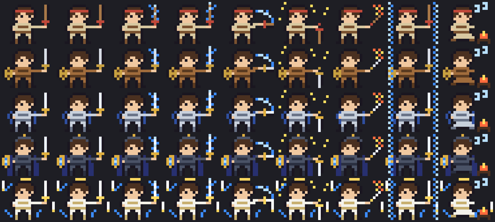

# spellblade — 마검사 키우기

Claude Code 를 쓴 만큼 자라는 판타지 마검사 Claude Mod.
Claude 가 도구를 쓰면 검을 휘두르고, 답을 쓰는 동안 검에 마법을 두르고, 쓴 토큰만큼 경험치가 쌓여
수련생 → 검사 → 마검사 → 마검기사 → 마검성으로 자란다. 터미널 `claude` 와 데스크톱 앱 Code 탭 양쪽에서 보인다.



## 어디에 보이나

| 자리 | 터미널 | 데스크톱 앱 |
|---|---|---|
| 스피너 옆 `· ⚔️ Lv.17 마검사 +34xp` | O | O |
| 프롬프트 위 밴드 — 도트 마검사 + 이름 · 레벨 · XP 막대 · 상태 | 도트(Raster) | Svg |
| `/blade` 카드 창 — 큰 그림 · 오늘/이번 주 XP · 베기 수 · 승급의 길 · 모험 일지 | 도트 2배 | Svg |
| 레벨업 · 승급 알림 | 토스트 | 토스트 |

창이 좁거나(64칸 미만) 밴드가 낮으면(8줄 미만) 밴드는 한 줄로 바뀐다. 다른 Mod 가 밴드에 그린 것은 가리지 않는다.

## 성장 규칙

- 경험치: `W = output + 0.1 × (input + cache_creation)` (캐시 읽기 제외), `XP = W ÷ 1,000`. 서브에이전트 몫도 센다.
- 레벨 L 이 되는 누적 XP = `60 × (L − 1)²`. 단계: 수련생 1 · 검사 5 · 마검사 15 · 마검기사 30 · 마검성 45.
- 보너스: 성공한 `git commit` +20, `gh pr create` +50 (하루 합계 300 까지).
- 경험치는 줄지 않는다. 안 쓰는 날에도 벌이 없다.
- 숫자는 `plugins/spellblade/hooks/lib/balance.ts` 한 곳에 있다.

여러 창을 동시에 켜도 세션마다 자기 칸(`d:<날짜>:<세션>`)에만 쓰고 읽을 때 합치므로 덮어쓰지 않는다. 다른 창에서 쌓인 몫은 1분 안에 보인다.

## 설치

```bash
claude plugin marketplace add ~/Documents/spellblade
claude plugin install spellblade@spellblade
```

열려 있는 세션에서는 `/reload-plugins` (또는 새 세션). Claude Code 2.1.287 이상(데스크톱 앱 내장 2.1.286 이상)이 필요하다.

업데이트: `plugin.json` 의 `version` 을 올린 뒤

```bash
claude plugin marketplace update spellblade
claude plugin update spellblade@spellblade
```

지우기: `claude plugin uninstall spellblade@spellblade`

## 명령 · 설정

| 명령 | 하는 일 |
|---|---|
| `/blade` | 마검사 카드 창 열기 (Esc 로 닫기) |
| `/blade name <이름>` | 이름 바꾸기 (1~12자) |
| `/blade demo` | 30초 동안 5단계 × 자세를 차례로 보여 주기 (저장소는 안 바꿈) |
| `/blade reset` | 한 번 더 물은 뒤 경험치 · 일지를 지우고 처음부터 |

`/blade` 가 내장 명령과 겹치는 버전에서는 `/spellblade` 로 등록된다.

설정 `band` (`/config`): `panel`(기본, 그림판) · `line`(한 줄) · `off`(밴드에 안 그림).

## 개발

```bash
claude --plugin-dir plugins/spellblade      # 파일을 저장하면 핫 리로드
claude plugin validate plugins/spellblade   # 훅 · 호출 정적 검사
claude plugin test plugins/spellblade       # 세션 · 네트워크 없이 테스트
```

- `$` 를 쓰는 코드는 `hooks/register.ts` 에만 있고, 계산 · 그림 · 화면 트리는 `hooks/lib/` 의 순수 함수다.
- 그림은 `hooks/lib/art.ts` 의 20×16 글자 격자. 데스크톱은 Svg, 터미널은 `▀` 반칸 Raster 로 같은 격자를 그린다.
- `--plugin-dir` 로 띄운 개발본은 설치본과 다른 저장 파일(`~/.claude/plugins/store/spellblade_inline-*.json`)을 쓴다.

## 안전

Mods 는 샌드박스 없이 내 권한으로 돈다. 이 Mod 는 파일 · 프로세스 · 네트워크 · 모델 호출을 하지 않는다
(`claude plugin validate` 의 `calls:` 줄에 `$.store` · `$.clock` · `$.session` · `$.ui` · `$.command` 만 나온다).
Bash 명령은 커밋 · PR 보너스를 판정할 때 문자열로만 읽고, 어디에도 저장하지 않는다.

## 라이선스

MIT. 그림은 이 프로젝트를 위해 새로 그렸다.
